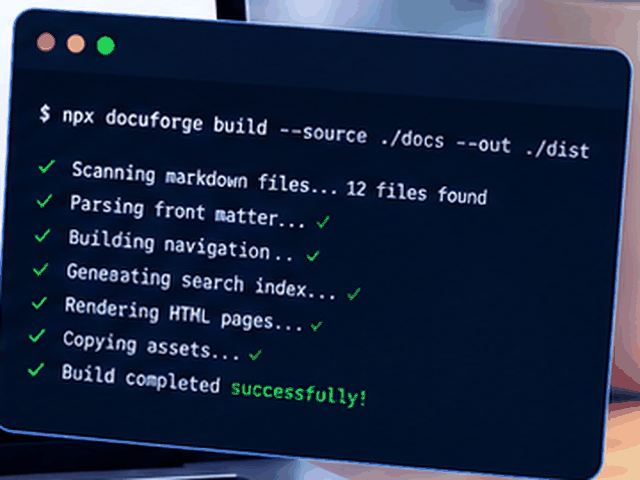

# Installation

Install with npm:

```bash
npm install -g acme-cli
acme --version
```




Next, continue to [Configuration](./configuration.md) or go back to the [home page](../index.md).

See the [deployment guide](../guides/deployment.md#rolling-back) for production notes.
This link is deliberately broken: [Troubleshooting](./troubleshooting.md).
